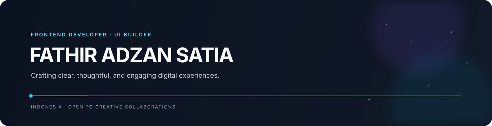

<div align="center">

<a href="https://tirr.my.id">
  
</a>

<br />
<br />

<a href="https://tirr.my.id"></a>
<a href="mailto:fathiradzans@gmail.com"></a>

<br />
<br />


</div>

<br />

## Fathir Adzan Satia

**Frontend developer building thoughtful digital experiences.**

I turn ideas into responsive interfaces that feel clear, fast, and intentional. My focus is the space between solid engineering and strong visual design: reusable systems, refined interactions, and products that are easy to use.

```ts
const profile = {
  role: "Frontend Developer",
  basedIn: "Indonesia",
  focus: ["Product interfaces", "Design systems", "Creative experiments"],
  stack: ["React", "Next.js", "TypeScript"],
};
```

## What I work on

<table>
<tr>
<td width="33%" valign="top">

### Product interfaces

Responsive web experiences with strong hierarchy, clean structure, and attention to detail.

</td>
<td width="33%" valign="top">

### Design systems

Reusable components and consistent patterns that help products scale without losing character.

</td>
<td width="33%" valign="top">

### Technical experiments

Computational projects and prototypes that keep me curious beyond the usual frontend stack.

</td>
</tr>
</table>

## Tech stack

<div align="center">


<br />
<br />

`React` · `Next.js` · `TypeScript` · `Tailwind CSS` · `Node.js` · `Figma`

</div>

## Selected work

<table>
<tr>
<td width="50%" valign="top">

### [tirr.my.id](https://tirr.my.id)

My portfolio and home for selected projects, experience, and frontend work.

**[Visit website ↗](https://tirr.my.id)** · **[View source ↗](https://github.com/FirstTirr/portofolio)**

</td>
<td width="50%" valign="top">

### [CFD-fortran](https://github.com/FirstTirr/CFD-fortran)

A computational fluid dynamics exploration built around numerical problem solving and Fortran.

**[View repository ↗](https://github.com/FirstTirr/CFD-fortran)**

</td>
</tr>
<tr>
<td width="50%" valign="top">

### [fortran-satelit](https://github.com/FirstTirr/fortran-satelit)

A technical exploration of satellite-related concepts through programming and experimentation.

**[View repository ↗](https://github.com/FirstTirr/fortran-satelit)**

</td>
<td width="50%" valign="top">

### More work

UI experiments, prototypes, and side projects across the rest of my repositories.

**[Browse repositories ↗](https://github.com/FirstTirr?tab=repositories)**

</td>
</tr>
</table>

## Currently

- Refining my portfolio and building better frontend experiences
- Exploring **Fortran** through computational projects
- Open to thoughtful collaborations and interesting products
- Happy to talk about **React, Next.js, UI, and frontend development**

## GitHub activity

<div align="center">

<a href="https://github.com/FirstTirr">
  
</a>
<a href="https://github.com/FirstTirr">
  
</a>

<br />
<br />


</div>

<br />

<div align="center">

<a href="mailto:fathiradzans@gmail.com"></a>

<br />
<br />

<sub>Designed and coded by Fathir Adzan Satia · <a href="https://tirr.my.id">tirr.my.id</a></sub>

</div>
